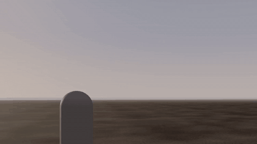
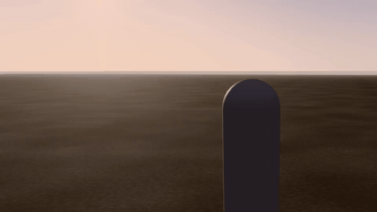
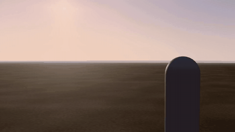

# rng-vfx

**A game VFX skill for coding agents.** Six styles, three engines, built and tested the way skills should be: by letting a fresh agent make effects with it and judging the results blind against an agent without it.

| Realistic frag grenade | Stylized MOBA slash | Anime magic hit |
|---|---|---|
|  |  |  |

Every effect above was made by a fresh agent in three.js from a one-paragraph brief, using only this skill and procedural shaders: no textures, no image generation, no hand edits.

## Why

Agents already know what League of Legends, Genshin or Battlefield effects look like. What they get wrong is the rest: a grenade drawn as a fuel fireball, smoke that floats off as one lump, effects too timid to have weight, nothing reacting on the target or the ground, jittery or aliased motion, and brightness that behaves differently in every engine. rng-vfx gives the agent the way a lead VFX artist works (brief, reference breakdown, plan, build in passes, review stills and motion against the reference) plus the knowledge that is easy to get wrong, and leaves the look to the genre's real references.

## What's inside

| | |
|---|---|
| `SKILL.md` | the seven qualities of a shipped effect and the process from brief to review |
| `references/styles/` | realism, stylized (MOBA), anime, toon, dark fantasy, pixel: look, typical timing, signature shapes, how generated versions fall short |
| `references/craft.md` | classical effects-animation principles (after Joseph Gilland's *Elemental Magic* I and II): animating energy, designed shapes, scale through timing and detail, choreography, magic |
| `references/elements.md` | slashes, flashes, projectiles, rings, sparks, debris, explosions by type, smoke, fire, splashes and liquids, lightning, impact frames, hit reactions, decals, light |
| `references/motion.md` | easing, flicker, stepped animation, popping, anti-aliasing, fast motion, hit stop, camera shake |
| `references/physics.md` | closed-form motion with drag, smoke, fire, explosions, sparks, debris, liquids |
| `references/brightness.md` | brightness relative to bloom in three.js, Unity URP and HDRP, Unreal |
| `references/engines/` | three.js, Unity (VFX Graph, Shuriken, Shader Graph), Unreal (Niagara, materials) |
| `scripts/capture_strip.py` | renders review stills and a frame-by-frame motion sheet of a web effect headlessly |

## Install

**Claude Code (plugin):**

```
/plugin marketplace add MRRengi/rng-vfx
/plugin install rng-vfx@rng-vfx
```

**Any agent that reads skills:** copy `skills/rng-vfx/` into the agent's skills folder (for Claude Code: `~/.claude/skills/rng-vfx/`).

**Other agents (Codex, Cursor, etc.):** point them at `AGENTS.md`, which routes to the same files.

## How it was tested

`evals/` holds the harness and the three briefs used above. Each round, one fresh agent built all three effects with the current skill, another built them without it, and the results were compared side by side as clips from the gameplay and close cameras. Four rounds changed the skill from a rulebook (which made agents timid and cartoonish) into a reference-driven process; in the last round the skill's versions won or tied every task. Run the same evals to check a change before you send it.

## License

MIT.
