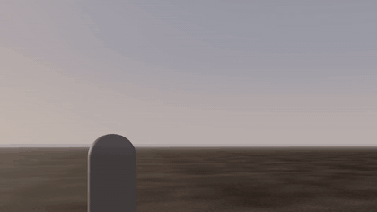
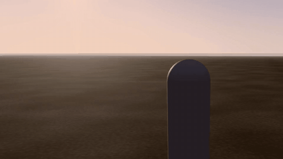
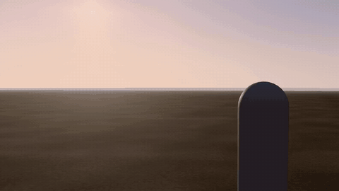
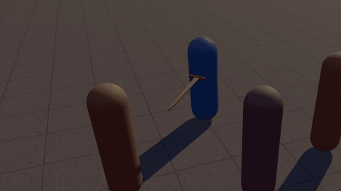
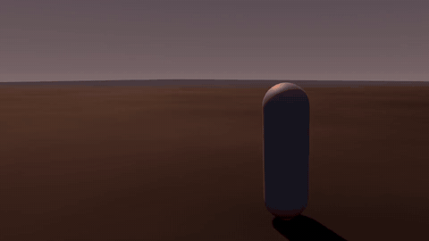
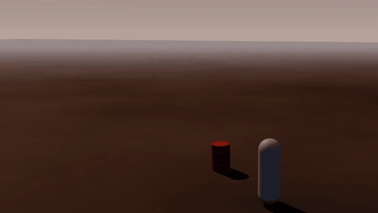
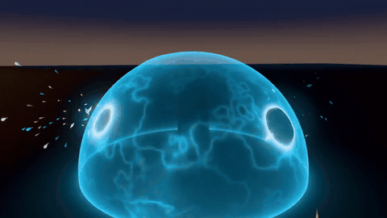

# rng-vfx

**A game VFX skill for coding agents.** Six styles, three engines, built and tested the way skills should be: by letting a fresh agent make effects with it and judging the results blind against an agent without it.

| Realistic frag grenade | Stylized MOBA slash | Anime magic hit |
|---|---|---|
|  |  |  |
| **Divine slash, isometric survivors-like** | **Dark fantasy blood nova** | **Realistic fuel barrel explosion** |
|  |  |  |
| **Sci-fi shield with floating breaches** | | |
|  | | |

Every effect above was made by a fresh agent in three.js, using only this skill and procedural shaders: no textures, no image generation, no hand edits. The divine slash came from one line a game developer would actually type: *"make me a slash on enemies in a divine style for my isometric top-down survivors-like"*. The shield came from *"a seamless sci-fi shield around the character, hits make beautiful floating holes in it"*.

## Why

Agents already know what League of Legends, Genshin or Battlefield effects look like. What they get wrong is the rest: a grenade drawn as a fuel fireball, smoke that floats off as one lump, effects too timid to have weight, nothing reacting on the target or the ground, jittery or aliased motion, and brightness that behaves differently in every engine. rng-vfx gives the agent the way a lead VFX artist works (brief, reference breakdown, plan, build in passes, review stills and motion against the reference) plus the knowledge that is easy to get wrong, and leaves the look to the genre's real references.

## What's inside

| | |
|---|---|
| `SKILL.md` | the seven qualities of a shipped effect and the process from brief to review |
| `references/styles/` | realism, stylized (MOBA), anime, toon, dark fantasy, pixel: look, typical timing, signature shapes, how generated versions fall short |
| `references/craft.md` | classical effects-animation principles (after Joseph Gilland's *Elemental Magic* I and II): animating energy, designed shapes and boundaries, large forms before detail, scale through timing and detail, choreography and rhythm, magic |
| `references/elements.md` | slashes, flashes, projectiles, rings, sparks, debris, explosions by type, smoke, fire, splashes and liquids, lightning, impact frames, hit reactions, decals, light |
| `references/motion.md` | easing, flicker, stepped animation, popping, anti-aliasing, fast motion, hit stop, camera shake |
| `references/physics.md` | closed-form motion with drag, smoke, fire, explosions, sparks, debris, liquids |
| `references/brightness.md` | brightness relative to bloom in three.js, Unity URP and HDRP, Unreal |
| `references/engines/` | three.js, Unity (VFX Graph, Shuriken, Shader Graph), Unreal (Niagara, materials) |
| `scripts/capture_strip.py` | renders review stills and a frame-by-frame motion sheet of a web effect headlessly, or a few chosen frames for fast iteration |

The knowledge comes from classical effects animation (Gilland), Riot's League of Legends VFX style guide and clarity articles, and the critiques senior artists give on [realtimevfx.com](https://realtimevfx.com): why a shockwave is invisible except where it kicks up dust, why debris must be lit like the ground, why a burst that lingers reads as weak, why a straight cut at the end of a trail looks cheap. Each rule says why, so the agent can apply it to effects the skill never mentions.

## Install

**Claude Code (plugin):**

```
/plugin marketplace add MRRengi/rng-vfx
/plugin install rng-vfx@rng-vfx
```

**Any agent that reads skills:** copy `skills/rng-vfx/` into the agent's skills folder (for Claude Code: `~/.claude/skills/rng-vfx/`).

**Other agents (Codex, Cursor, etc.):** point them at `AGENTS.md`, which routes to the same files.

## How it was tested

`evals/` holds the harness and the protocol. Each round, two fresh agents get the same effect request: one with the skill, one without. The results are compared side by side as clips from the gameplay and close cameras by a game developer who ships his own VFX. Since round 8 the requests are written by him in his own words, and the agents get nothing else: no hints on how to build or check the effect, so the test measures the skill and not the prompt.

Ten rounds so far. The early rulebook version made agents timid and cartoonish and lost to the baseline; the reference-driven rewrite started winning; craft principles, artist critiques and the rule that every boundary of an effect is designed turned it into a clear win ("better by an order of magnitude" on the last round). Feedback was never patched in as a rule for one effect: each complaint became a general principle with its reason. Results per round are in [`evals/README.md`](evals/README.md). Run the same evals to check a change before you send it.

## License

MIT.
