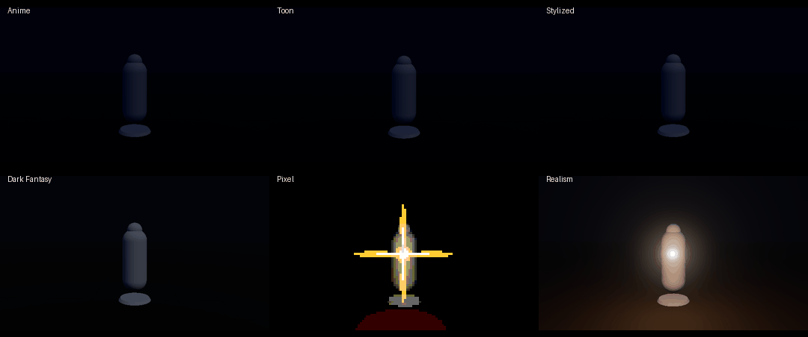
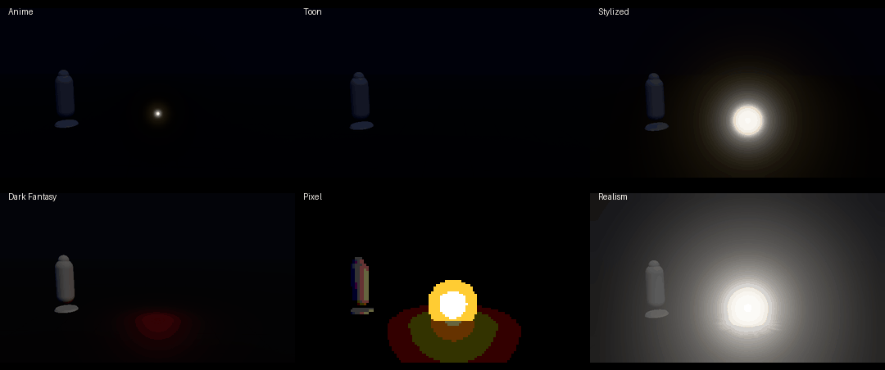

# rng-vfx

**A game VFX skill for coding agents.** Six styles, three engines, and a live stand to check the result.





Most AI-made effects look cheap for the same reasons: linear timing, everything glowing at once, one sprite doing every job, alpha fades instead of designed dissipation, no idea what makes anime look like anime or realism look real. rng-vfx gives an agent the process a VFX artist actually follows, from the gameplay brief to a verified frame strip.

**[Open the stand](https://mrrengi.github.io/rng-vfx/)** · scrub, step frames, toggle grayscale, compare engine renders.

## What's inside

| | |
|---|---|
| **Process** | brief, style, frame breakdown, timing, layers, textures, shaders, motion, engine, budget, verification |
| **Styles** | Anime (sakuga, cel 3D), Toon, Stylized (MOBA / hero shooter), Dark Fantasy (ARPG), Pixel, Realism |
| **Physics** | closed-form ballistic motion with drag, curl turbulence, buoyant smoke, blackbody fire, explosion phases, sparks, debris, liquids |
| **Shaders** | erosion, gradient maps, step shading, fresnel, polar UVs, soft particles, flipbooks with motion vectors, distortion, SDF shapes, dithering, flow maps, with Unity Shader Graph and Unreal node maps |
| **Materials** | blend modes, HDR and bloom, lit vs unlit, sorting, presets per style |
| **Textures** | the texture kit, authoring rules, `tools/texgen.py` (procedural noises, shapes, ramps, flipbooks, channel packing), EffectTextureMaker, image-model prompting, Rengi Forge tools |
| **Engines** | Unity (VFX Graph, Shuriken, Shader Graph, headless frame strips without Play mode), Unreal (Niagara, materials, Movie Render Queue from the command line), three.js |
| **Performance** | budgets per platform, overdraw rules, scalability |
| **Verification** | frame strips, checklist, the stand and its script API |

## Install

**Claude Code (plugin):**

```
/plugin marketplace add MRRengi/rng-vfx
/plugin install rng-vfx@rng-vfx
```

**Any agent that reads skills:** copy `skills/rng-vfx/` into the agent's skills folder (for Claude Code: `~/.claude/skills/rng-vfx/`).

**Other agents (Codex, Cursor, etc.):** point them at `AGENTS.md`, which routes to the same files.

## The stand

`stand/` is a static three.js page, no build step:

```
python -m http.server 8000 -d stand
# open http://localhost:8000/#style=anime&fx=impact
```

- Timeline with play, scrub, frame step (respects the style's drawings per second), slow motion and loop.
- Four backgrounds (dark, field, mid gray, bright), four cameras (close, gameplay, side, low), grayscale, bloom and exposure controls.
- Impact frame, camera shake and drawings-per-second toggles.
- Save frame strips, peak strips (frames packed around contact) and single frames.
- **Compare mode:** drop Unity, Unreal or three.js renders next to the live effect; videos follow the stand's timeline frame by frame. Commit renders to `stand/renders/` with a `manifest.json` entry to keep them.
- `window.rngStand` API for headless checks with Playwright.

Under the hood: a shared tiling noise texture for every eroding body, soft particles from a depth prepass, a distortion buffer for shockwaves and heat, premultiplied fire that cools into smoke, smoke lit by its own fire, a dummy that reacts (flash, rim light, jolt, lean), shadows from big effect lights and a textured floor. Every effect is a pure function of time with seeded randomness, so any frame can be reproduced exactly.

## Optional tools

- [Rengi Forge](https://forge.rengi.dev) (MCP): video to flipbook, background removal, normal maps, seamless tiling, channel packing, atlases, pixelation. The skill tells the agent when to use each tool if the server is connected.
- [EffectTextureMaker](https://mebiusbox.github.io/en/docs/lab/effect_texture_maker) by mebiusbox: browser VFX texture generator, outputs are CC0.

## Credits

Built on the ideas of people who published how effects really work: Joseph Gilland's *Elemental Magic*, Riot Games' League of Legends VFX style guide, Arc System Works' GDC 2015 talk on Guilty Gear Xrd, Robert Bridson's fluid work, and the Real Time VFX community. Full list in [`skills/rng-vfx/references/sources.md`](skills/rng-vfx/references/sources.md). All text here is original; nothing is copied from those works.

The stand uses [three.js](https://threejs.org) and [lil-gui](https://lil-gui.georgealways.com), both MIT, vendored in `stand/vendor/`.

## License

MIT. Made by [Maks](https://rengi.dev).
